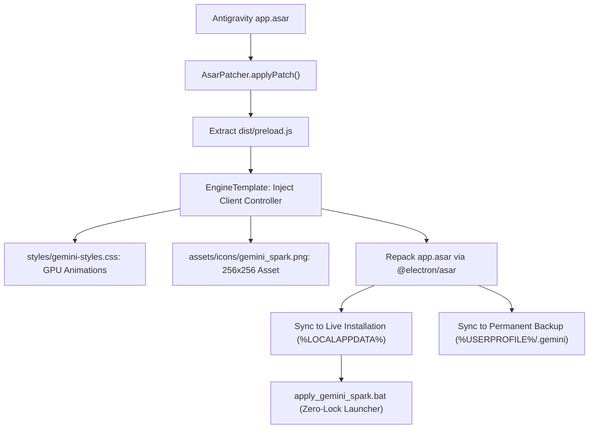

# agy-to-spark

> High-fidelity, version-independent rebranding and thinking engine transforming Google Antigravity into Gemini Spark.

[](https://github.com/Hyelcyon/agy-to-spark/actions/workflows/ci.yml)
[](LICENSE)
[](package.json)

---

## 1. Overview

`agy-to-spark` is an automated patch and runtime injection engine that converts the Google Antigravity desktop IDE into **Gemini Spark**.

Rather than copying hardcoded, version-locked `app.asar` blobs that break on application updates, `agy-to-spark` operates as a dynamic **Mode B** patcher: it unpacks the live Electron application archive, injects an isolated lifecycle controller into `dist/preload.js`, and repacks the package.

---

## 2. Architecture



---

## 3. Quick Start & Usage

### Method A: Automated Windows Launcher (.bat)
Run `bin/apply_gemini_spark.bat` directly or from your desktop:
```cmd
bin\apply_gemini_spark.bat
```
The batch script:
1. Detects and gracefully closes any active `Antigravity.exe` instances to prevent Windows file lock errors (`EBUSY`).
2. Synchronizes the patched `app.asar` archive.
3. Automatically launches Gemini Spark.

### Method B: Node.js CLI
```bash
# Clone the repository
git clone https://github.com/Hyelcyon/agy-to-spark.git
cd agy-to-spark

# Install dependencies
npm ci

# Apply the patch to the live Antigravity installation
npm run patch

# Restore original unmodified Antigravity archive
npm run restore

# Run verification suite
npm run verify
```

### CLI Command Options
```text
Usage:
  agy-to-spark [command] [options]

Commands:
  apply      Patch Antigravity with Gemini Spark branding & thinking engine (default)
  restore    Restore original unmodified app.asar backup
  status     Display installation, process, and patch status
  help       Show help message

Options:
  -h, --help     Show help
  -v, --version  Show version
  -l, --launch   Automatically launch Antigravity after patching
```

---

## 4. Project Layout

```text
agy-to-spark/
├── .github/
│   └── workflows/
│       └── ci.yml               # GitHub Actions workflow (Node 18/20/22 on Windows)
├── assets/
│   ├── icons/
│   │   ├── gemini_spark.png     # Authentic 256x256 high-resolution icon
│   │   └── gemini_spark.ico     # Multi-resolution Windows icon
│   └── spark.svg                # Authentic SVG vector
├── bin/
│   ├── apply_gemini_spark.bat   # Zero-lock English Windows launcher
│   └── cli.js                   # Node.js command-line interface
├── src/
│   ├── core/
│   │   ├── asar-patcher.js      # Archive unpacking, modification, and repacking
│   │   ├── asset-resolver.js    # Resolves and base64-encodes authentic assets
│   │   └── engine-template.js   # Generates client preload runtime injection
│   ├── styles/
│   │   └── gemini-styles.css    # Wave animation, 4-dot convergence, circle rules
│   ├── utils/
│   │   ├── path-locator.js      # Resolves installation and backup paths
│   │   └── process-manager.js   # Safe process detection, termination, and launch
│   └── index.js                 # Public programmatic API
├── scripts/
│   └── verify.js                # End-to-end verification script
├── tests/
│   ├── assets.test.js           # Asset integrity unit tests
│   └── patcher.test.js          # Engine code syntax and invariant unit tests
├── CHANGELOG.md                 # Complete historical bug fix ledger
├── LICENSE                      # MIT License
├── package.json                 # Package configuration
└── README.md                    # Technical documentation
```

---

## 5. Verification & Testing

Run the test suite and verification check:
```bash
npm test
npm run verify
```

All tests execute against Node.js native test runner (`node:test`) and require zero external test runner dependencies.

---

## 6. License

This project is licensed under the [MIT License](LICENSE).
